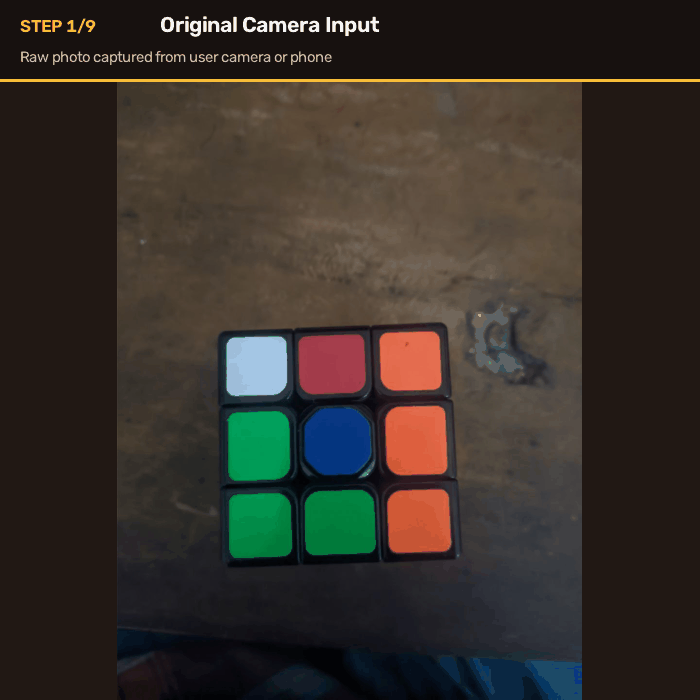

# 🧩 Rubik's Cube Computer Vision Pipeline & Solver Studio

An end-to-end computer vision pipeline and interactive web debugger that captures photos of a Rubik's Cube, isolates and classifies all 54 stickers, validates physical 3D cube parity, and computes the optimal two-phase Kociemba solve in real time.

---

## 🎬 Pipeline in Action

Below is an animated demonstration showing the 9 intermediate stages a single camera photo undergoes:



1. **Camera Input**: Raw photo containing ambient lighting, perspective distortion, and background.
2. **Chromatic Color Mask**: High-saturation pixel isolation (`S >= 40, V >= 80`).
3. **Achromatic White Mask**: Low-saturation bright pixel isolation (`S < 40, V >= 200`).
4. **Morphological Cleaning**: Bitwise OR followed by `cv2.MORPH_OPEN` and `cv2.MORPH_CLOSE`.
5. **Raw Contours**: Contour detection across sticker and background boundaries.
6. **Geometric Filtering**: Area (`> 100 px`) and Rectangularity ratio (`> 0.60`) filtering.
7. **9-Sticker Optimization**: Fast-path compactness calculation (`Area Sum / Bounding Box >= 0.70`) with combinatorial fallback.
8. **Perspective Homography**: Convex hull corner detection warped to a canonical 300×300 pixel square.
9. **Grid Ordering & Extraction**: Row-major sticker sorting (#1–#9) and CIE Lab center sampling.

---

## 🚀 Key Features

- **⚡ Instant Kociemba Solver**: Displays the exact move sequence (e.g., `R L D2 B' L2 ...`) and move count right at the top of the interface.
- **📸 Side-by-Side 6-Face Inspection**: View all 6 cropped normalized faces beside their extracted 3×3 color swatch palettes.
- **🎨 Perceptual CIE Lab Color Engine**: Classifies stickers based on Euclidean distance in CIE $L^*a^*b^*$ color space, avoiding hue-wrapping errors under warm/cool lighting.
- **🔍 Click-to-Highlight Distribution**: Click any color in the distribution bar (`[U]`, `[R]`, `[F]`, etc.) to instantly highlight matching stickers across all faces with glowing outlines while dimming the rest.
- **✏️ Interactive Sticker Overrides**: Misclassified sticker due to extreme glare? Correct it directly using per-sticker dropdowns.
- **🔄 In-Place Face Rotations**: Rotate individual faces by 90°, 180°, or 270° clockwise with one click if a photo was captured at an angle.
- **📊 Physical Parity & Validation Diagnostics**: Real-time auditing of all 8 corner pieces and 12 edge pieces against the physical Rubik's cube master inventory.
- **📋 Real-Time Activity & State Audit Log**: Timestamped record of every threshold change, rotation, manual override, and state JSON export.

---

## 📷 Photo Capture Protocol

To ensure 100% accurate computer vision extraction and physical 3D consistency, follow these guidelines:

### 1. Where to Place Photos
Place your 6 photos inside the `sample_faces/` directory:
```bash
sample_faces/
├── photo_1_2025-10-22_11-28-04.jpg
├── photo_2_2025-10-22_11-28-04.jpg
├── photo_3_2025-10-22_11-28-04.jpg
├── photo_4_2025-10-22_11-28-04.jpg
├── photo_5_2025-10-22_11-28-04.jpg
└── photo_6_2025-10-22_11-28-04.jpg
```
*Supported formats: `.jpg`, `.jpeg`, `.png`, `.bmp`.*

### 2. Naming Conventions
Files are discovered dynamically and sorted alphabetically. You can name them:
- `photo_1.jpg`, `photo_2.jpg`, ... `photo_6.jpg`
- Or include timestamps: `photo_1_2026-09-27.jpg`

### 3. Recommended Capture Order & Cube Orientation

To match standard Kociemba coordinates ($U, R, F, D, L, B$):

1. **Up (U)** — e.g. **Orange** (or White)
2. **Right (R)** — e.g. **White** (or Red)
3. **Front (F)** — e.g. **Green**
4. **Down (D)** — e.g. **Red** (or Yellow)
5. **Left (L)** — e.g. **Yellow** (or Orange)
6. **Back (B)** — e.g. **Blue**

> **Photo Tips:**
> - Keep the cube face reasonably perpendicular to the camera (tilt $< 25^\circ$).
> - Ensure diffuse lighting (avoid harsh flashlight reflections directly on sticker centers).
> - Keep the entire face and outer black border within the frame.

---

## 🛠️ Setup & Installation

### Prerequisites
- Python 3.10+
- Linux (Ubuntu / Mint / Debian), macOS, or Windows

### Step 1: Clone the Repository
```bash
git clone https://github.com/suptos35/rubiks-cube-cv-solver.git
cd rubiks-cube-cv-solver
```

### Step 2: Create and Activate Virtual Environment
```bash
python3 -m venv .venv
source .venv/bin/activate
```
*(On Windows: `.venv\Scripts\activate`)*

### Step 3: Install Dependencies
```bash
pip install -r requirements.txt
```
Or install directly:
```bash
pip install opencv-python numpy kociemba streamlit pillow
```

---

## 💻 Running the Studio

### 1. Interactive Web Studio (Streamlit)
```bash
streamlit run app.py
```
Open your browser at `http://localhost:8501`.

### 2. Native OpenCV Debug Viewer (Alternative)
For headless or lightweight native desktop inspection with OpenCV sliders:
```bash
python debug_viewer.py
```
*(Press `q` or `Esc` to exit).*

---

## 🧠 Pipeline Architecture

```
                    Raw Photo
                       │
              ┌────────┴────────┐
              ▼                 ▼
         Color Mask        White Mask
       (S >= 40, V >= 80) (S < 40, V >= 200)
              │                 │
              └────────┬────────┘
                       ▼
            Cleaned Binary Mask (Morph Open + Close)
                       │
                       ▼
                 Raw Contours
                       │
                       ▼
            Geometric Filters (Area & Rectangularity)
                       │
                       ▼
         9-Sticker Selection (Fast-Path / Fallback)
                       │
                       ▼
       Perspective Normalization (Homography to 300x300)
                       │
                       ▼
           Center Color Lab Distance Classification
                       │
                       ▼
          Physical Geometry Validation (Corners & Edges)
                       │
                       ▼
             Kociemba Two-Phase Optimal Solver
```

---

## 📁 Project Structure

```
rubic/
├── app.py                 # Interactive Streamlit Web Studio
├── pipeline.py            # Core Computer Vision pipeline & validation logic
├── debug_viewer.py        # Native OpenCV trackbar debug viewer
├── generate_gif.py        # Script to render the step-by-step pipeline animation
├── assets/
│   └── pipeline_steps.gif # Visual demonstration of pipeline stages
├── sample_faces/          # Test sample photographs
├── requirements.txt       # Python dependencies
├── LICENSE                # MIT License
├── .gitignore             # Git ignore rules
└── README.md              # Project documentation
```

---

## 📜 License

Distributed under the MIT License. See [LICENSE](LICENSE) for details.
